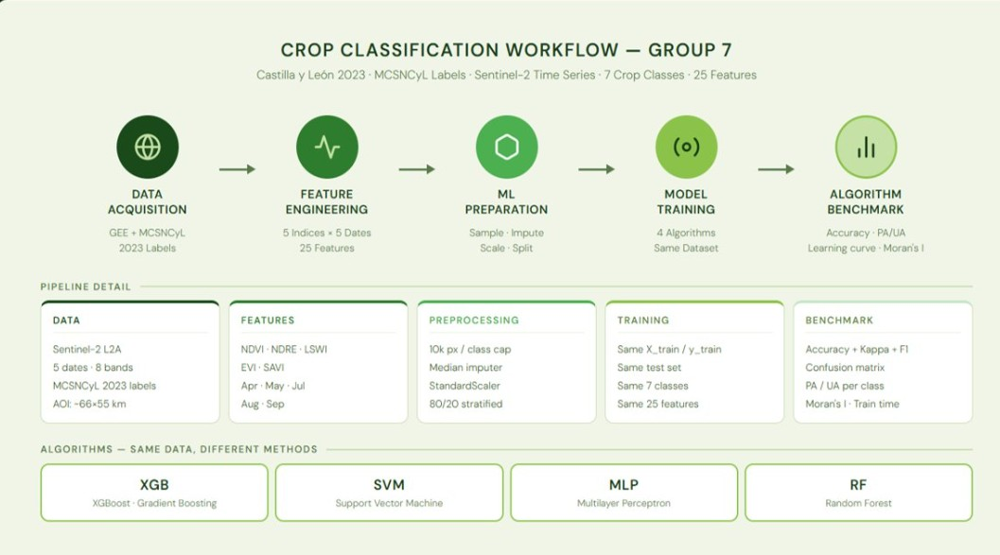
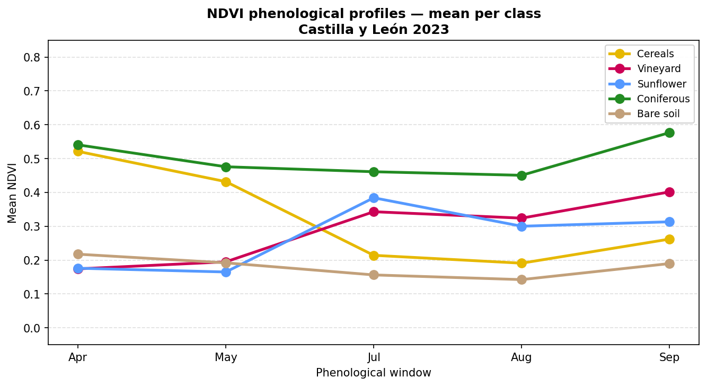
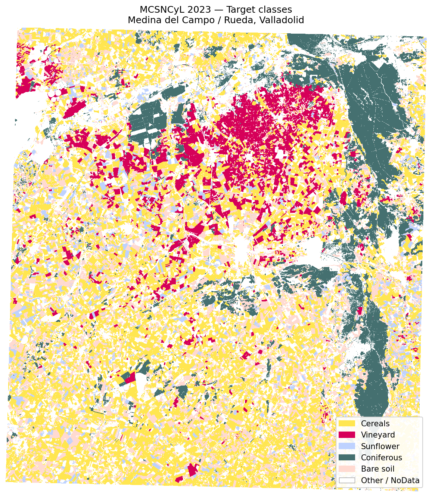

# Crop Type Classification with SVM — Castilla y León, 2023

Classifying **7 crop / land-cover classes** from a **Sentinel-2 time series** with a Support Vector Machine.
The tuned model reaches **91.8 % overall accuracy** (Cohen's κ = 0.90) on a held-out test set of 14,000 pixels.

> The repository is named "Crop Health Monitoring", but what it actually does is **crop type classification**.
> It is the SVM part of a group assignment (ITC, Q3 Machine Learning, Group 7) in which four algorithms — SVM, XGBoost, MLP and Random Forest — were trained on the same dataset. Only the SVM work lives here.



## The idea in one picture

On any single date, many crops look alike. Across a season they do not: cereals are green in spring and harvested by July, sunflower peaks in summer, conifers stay green all year. Feeding the classifier five dates instead of one is what makes the problem solvable.

<p>
  
  
</p>

*Left: mean NDVI per class across the season. Right: the label map of the study area. Both figures show 5 of the 7 classes (Maize and Olives are not drawn).*

## Data

| | |
|---|---|
| **Study area** | Medina del Campo / Rueda, Valladolid (Spain) — 5150 × 5665 px at 10 m ≈ 51 × 57 km, EPSG:25830 |
| **Labels** | MCSNCyL 2023 crop map (ITACyL) |
| **Imagery** | Sentinel-2 L2A, five dates: Apr · May · Jul · Aug · Sep |
| **Features** | 5 indices (NDVI, NDRE, LSWI, EVI, SAVI) × 5 dates = **25 features** per pixel |
| **Samples** | 10,000 pixels per class, balanced → 56,000 train / 14,000 test (80/20, stratified) |

| Label | Class | MCSNCyL code |
|:-:|---|---|
| 0 | Cereals | 31 (wheat) + 32 (barley) |
| 1 | Vineyard | 13 |
| 2 | Sunflower | 50 |
| 3 | Coniferous | 120 |
| 4 | Bare soil | 20 |
| 5 | Maize | 42 |
| 6 | Olives | 116 |

Wheat and barley are merged into one class: their seasonal profiles are nearly identical, and an earlier version that kept them apart confused them heavily (see below).

## Results

All numbers are on the 14,000-pixel test set and come from the saved outputs of the notebook.

| Model | Test accuracy |
|---|---|
| Earlier version — single date, 4 bands, wheat & barley separate | 63.2 % |
| RBF SVM, default (C=1, gamma=scale), 25 features | 89.6 % |
| RBF SVM, top 20 of 66 engineered features | 90.7 % |
| **RBF SVM, tuned (C=100, gamma=auto), 25 features** | **91.8 %** |

Tuned model: **OA 91.84 % · macro F1 0.918 · Cohen's κ 0.905**

<p>
  
  
</p>

*Left: the tuned time-series model (row %). Right: the earlier single-date model (counts), where wheat/barley and vineyard/bare soil are mixed up.*

Per-class accuracy of the tuned model:

| Class | Producer's acc. (recall) | User's acc. (precision) |
|---|:-:|:-:|
| Maize | 97.0 % | 97.1 % |
| Coniferous | 95.6 % | 96.1 % |
| Cereals | 93.5 % | 89.8 % |
| Olives | 93.2 % | 89.5 % |
| Vineyard | 90.0 % | 93.1 % |
| Sunflower | 88.7 % | 89.8 % |
| Bare soil | 84.9 % | 87.5 % |

What the results say:

- **The time series is what matters.** Going from one date to five lifted accuracy from ~63 % to ~90 % before any tuning.
- **Summer dates carry the most signal.** The August indices rank highest by ANOVA F-score, followed by July.
- **Tuning helped a little (+2.2 points); feature engineering helped less.** Adding temporal differences, ratios and squared terms and keeping the best 20 gave 90.7 % — below the tuned model on the plain 25 features.
- **Bare soil is the hardest class**, most often mistaken for cereals (which are bare after harvest).

## Repository layout

```
├── Data/
│   ├── X_train.npy, X_test.npy      # 25 features per pixel, already standardised
│   ├── y_train.npy, y_test.npy      # class labels 0–6
│   ├── metadata.pkl                 # class names, feature names, raster shape (Git LFS)
│   └── mcsncyl_2023_aoi.tif         # label raster clipped to the study area (Git LFS)
├── notebooks/
│   ├── svm_crop_classification_timeseries.ipynb   # full SVM analysis — start here
│   └── Gasmalla_3708748_SVM.ipynb                 # shorter copy handed in for the assignment
├── figures/                         # figures used in this README and the report
└── requirements.txt
```

## Run it

```bash
git lfs pull
```

```bash
pip install -r requirements.txt
```

Then open `notebooks/svm_crop_classification_timeseries.ipynb` and run it top to bottom (developed on Python 3.11). The grid search and the final fits on 56,000 samples take a while.

## Good to know

- **The "unscaled vs scaled" comparison shows no difference** (89.62 % both). `X_train.npy` was already standardised when it was exported, so scaling it again changes nothing. The comparison is not evidence that scaling is unnecessary for an SVM.
- **The data preparation is not in this repository.** Downloading Sentinel-2 from Google Earth Engine, computing the indices and sampling pixels was done in a separate Colab notebook; this repo starts from the sampled arrays.
- **No classification map is produced here** — the notebooks stop at test-set evaluation.
- **Hyper-parameters were searched on a 10,000-pixel subsample** (3-fold CV, 16 combinations), then the best setting was refit on the full training set.
- **Train and test pixels are random samples from the same area**, so neighbouring pixels of one field can land on both sides. Expect lower accuracy on a different region or year.
- `Gasmalla_3708748_SVM.ipynb` does not run cleanly top to bottom (two cells use variables defined later); use the other notebook to reproduce.

## Team

Group 7 — ITC Masters, Q3 Machine Learning assignment. Earlier group work (raw data, phenology exploration) is on the branches `Mo`, `Anisha`, `Miren` and `Zillah`.

Licensed under the [MIT License](LICENSE).
