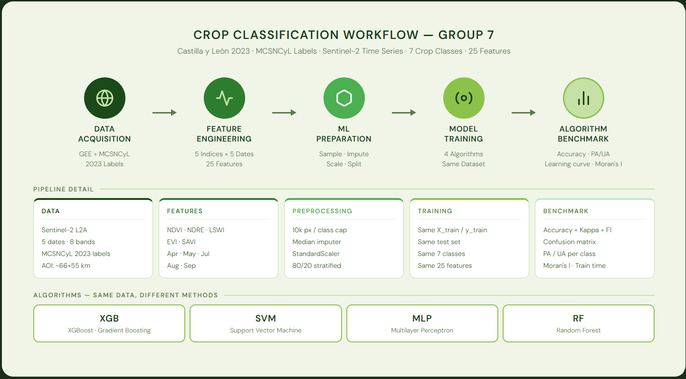
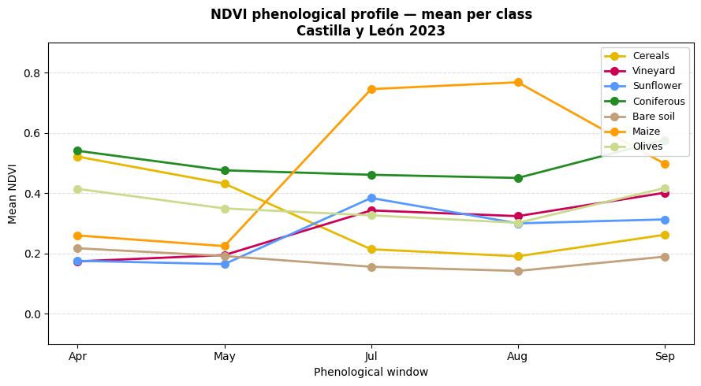
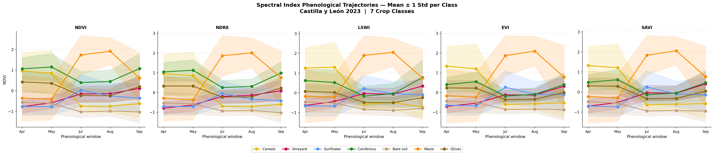
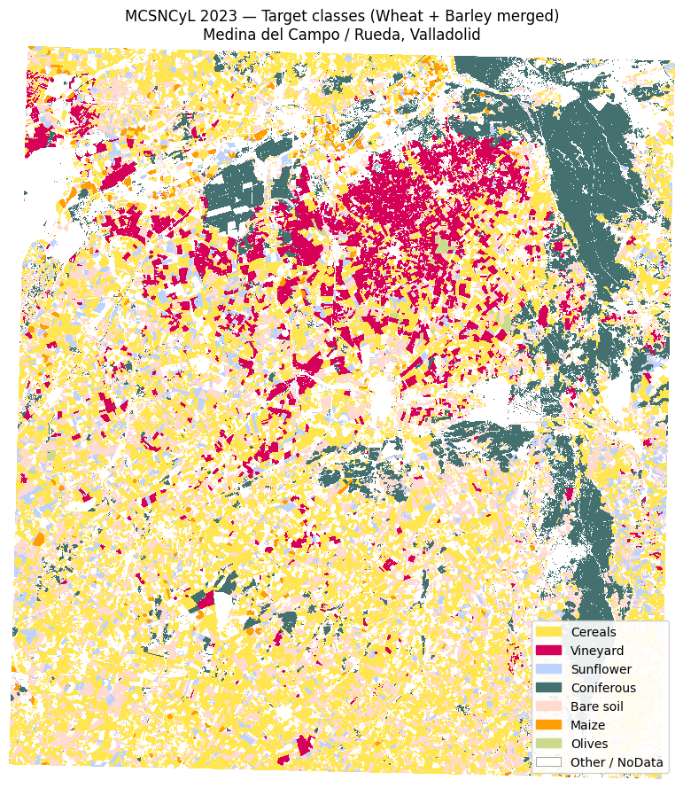
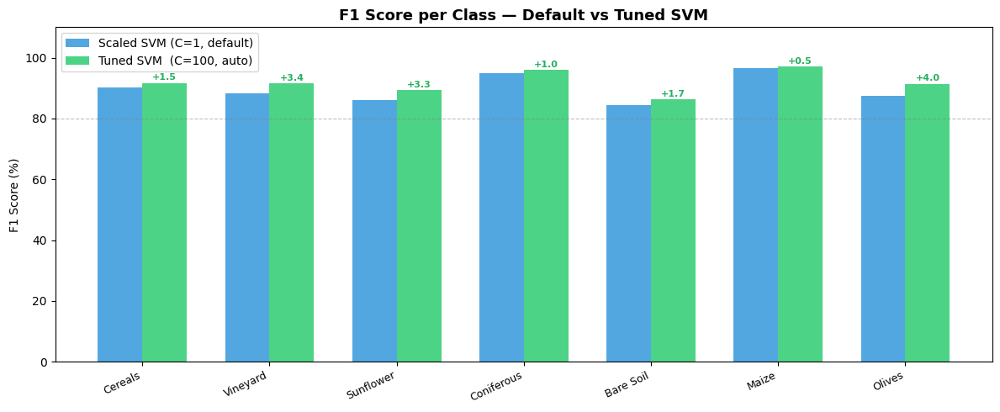
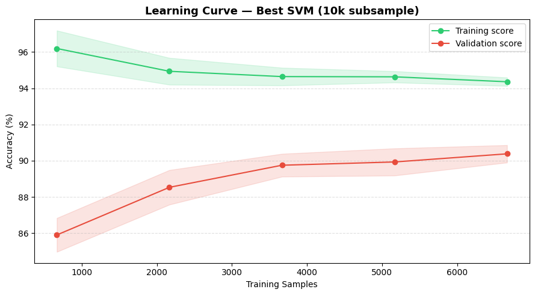
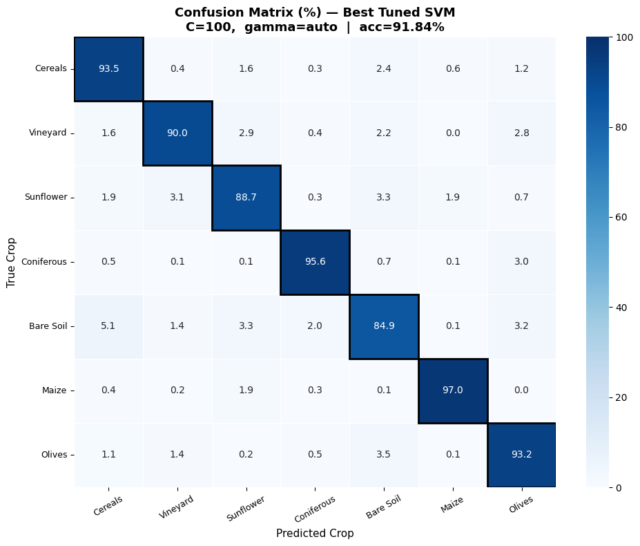
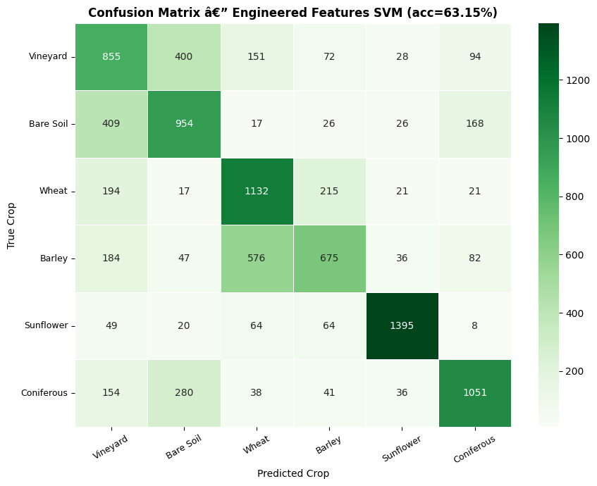
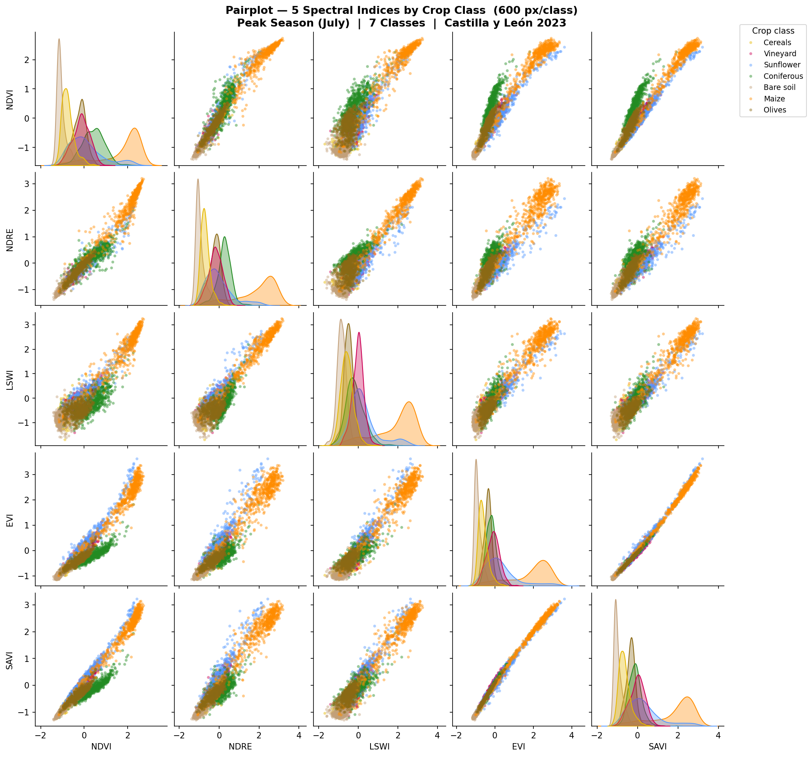

# Crop Type Classification from Sentinel-2 Time Series with SVM

Mapping **7 crop and land-cover classes** in Castilla y León, Spain (2023) with a Support Vector Machine trained on a multi-date Sentinel-2 feature set.

**Result: 91.8 % overall accuracy · Cohen's κ 0.90 · macro F1 0.92** on 14,000 held-out pixels.

This is the SVM component of a four-algorithm benchmark (SVM, Random Forest, XGBoost, MLP) carried out as a group project at ITC, where every model was trained on the same features, classes and train/test split.

<p align="center"></p>

## Why a time series

On a single date many crops look alike. Across a season they do not: cereals are green in spring and harvested by July, sunflower peaks in summer, conifers stay green all year. Describing each pixel by five dates instead of one is what makes the classes separable.

<p align="center"></p>

The same holds for all five spectral indices. Each class follows its own path through the season, and maize stands apart from July onward:

<p align="center"></p>

*Mean ± 1 standard deviation per class, in standardised units.*

## Data

| | |
|---|---|
| **Study area** | Medina del Campo / Rueda, Valladolid — about 51 × 57 km at 10 m resolution |
| **Reference labels** | MCSNCyL 2023 crop map (ITACyL) |
| **Imagery** | Sentinel-2 L2A, five dates: Apr · May · Jul · Aug · Sep |
| **Features** | 5 spectral indices (NDVI, NDRE, LSWI, EVI, SAVI) × 5 dates = **25 features** per pixel, standardised |
| **Samples** | 10,000 pixels per class, balanced → 56,000 train / 14,000 test (80/20, stratified) |

<p align="center"></p>

**Classes:** Cereals (wheat + barley) · Vineyard · Sunflower · Coniferous · Bare soil · Maize · Olives

Wheat and barley are merged into one class because their seasonal profiles are nearly identical.

## Model

An RBF-kernel SVM, wrapped in a one-vs-rest scheme for the 7 classes, tuned with a grid search.

| | Baseline | Grid search | Best model |
|---|---|---|---|
| **kernel** | rbf | rbf | rbf |
| **C** | 1.0 | 0.1, 1, 10, 100 | **100** |
| **gamma** | scale | scale, auto, 0.01, 0.1 | **auto** (1 / 25 = 0.04) |
| **multi-class** | one-vs-rest | — | one-vs-rest |
| **Test accuracy** | 89.6 % | 3-fold CV on a 10,000-pixel subset | **91.8 %** |

- **RBF kernel** — crop classes are not linearly separable in index space; the kernel lets the SVM draw curved boundaries.
- **C = 100** — a high penalty on misclassified training pixels, giving a tighter fit than the default. The learning curve shows this does not overfit badly: validation accuracy keeps rising with more data.
- **gamma = auto** — each support vector influences a fairly wide neighbourhood, which keeps the boundaries smooth.
- **Grid search on a subset** — SVM training time grows faster than linearly with sample count, so the 16 combinations were searched on 10,000 pixels and the winner was refit on all 56,000.

<p align="center">
  
  
</p>

*Left: tuning improves F1 for every class. Right: validation accuracy is still rising as training data grows.*

## Results

| Model | Test accuracy |
|---|---|
| Single-date baseline (4 bands, 6 classes) | 63.2 % |
| SVM, default parameters, 25 time-series features | 89.6 % |
| SVM, top 20 of 66 engineered features | 90.7 % |
| **SVM, tuned, 25 time-series features** | **91.8 %** |

<p>
  
  
</p>

*Left: tuned time-series model (row %). Right: the single-date baseline (pixel counts), where wheat/barley and vineyard/bare soil are heavily confused.*

Per-class accuracy of the tuned model:

| Class | Producer's accuracy (recall) | User's accuracy (precision) |
|---|:-:|:-:|
| Maize | 97.0 % | 97.1 % |
| Coniferous | 95.6 % | 96.1 % |
| Cereals | 93.5 % | 89.8 % |
| Olives | 93.2 % | 89.5 % |
| Vineyard | 90.0 % | 93.1 % |
| Sunflower | 88.7 % | 89.8 % |
| Bare soil | 84.9 % | 87.5 % |

**Takeaways**

- **The time series is what matters.** Moving from one date to five lifted accuracy from about 63 % to about 90 % before any tuning.
- **Summer carries the most signal.** The August indices rank highest by ANOVA F-score, followed by July.
- **Tuning beat feature engineering.** Tuning C and gamma added 2.2 points. Adding temporal differences, index ratios and squared terms, then keeping the best 20, added only 1.1.
- **Bare soil is the hardest class**, most often mistaken for cereals, whose fields are bare after harvest.

<details>
<summary>How the five indices relate to each other (July)</summary>
<br>
<p align="center"></p>

The indices are strongly correlated within a single date — EVI and SAVI almost perfectly. Most of the discriminating power comes from the change between dates rather than from stacking more indices.
</details>

## Benchmark against the other algorithms

All four models used the same 25 features, 7 classes and train/test split. The SVM is documented in this repository; the other three were built by the other group members.

| Algorithm | Overall accuracy | Cohen's κ | Macro F1 |
|---|:-:|:-:|:-:|
| Random Forest | 90.07 % | 0.884 | 0.901 |
| XGBoost | 90.25 % | 0.886 | 0.902 |
| **SVM** | **91.84 %** | **0.905** | **0.918** |
| MLP | 91.93 % | 0.906 | 0.919 |

- **All four models pass 90 %**, within 2 points of each other — the features matter more than the algorithm.
- **August is the most informative date in every model.**
- **Maize and Coniferous are the easiest classes; Sunflower and Bare soil the hardest**, consistently across models.

## Limitations

- **Accuracy is measured on a random pixel split.** Neighbouring pixels from one field can fall in both train and test, which flatters the score. In the group's Random Forest experiment, switching to a spatial (checkerboard) split lowered accuracy by about 3.6 points; a similar effect should be expected for the SVM.
- **One region, one year.** The model has not been tested on another area or season.
- **Only the 7 target classes are modelled**, so roads, water and urban pixels would be forced into one of them in a wall-to-wall map.

Natural next steps are spatial cross-validation, a cross-year transfer test, adding Sentinel-1 radar, and a background class.

## Repository

```
├── Data/
│   ├── X_train.npy, X_test.npy      # 25 standardised features per pixel
│   ├── y_train.npy, y_test.npy      # class labels 0–6
│   ├── metadata.pkl                 # class names, feature names, raster shape (Git LFS)
│   └── mcsncyl_2023_aoi.tif         # reference crop map of the study area (Git LFS)
├── notebooks/
│   ├── svm_crop_classification_timeseries.ipynb   # full analysis
│   └── Gasmalla_3708748_SVM.ipynb                 # condensed version
├── figures/
└── requirements.txt
```

Image download, index computation and pixel sampling were done upstream in the group's shared Google Earth Engine / Colab pipeline; this repository starts from the sampled arrays.

## Run it

```bash
git lfs pull
```

```bash
pip install -r requirements.txt
```

Then open `notebooks/svm_crop_classification_timeseries.ipynb` (Python 3.11). The grid search and the fits on 56,000 samples are slow, so expect a long run.

## License

[MIT](LICENSE)
